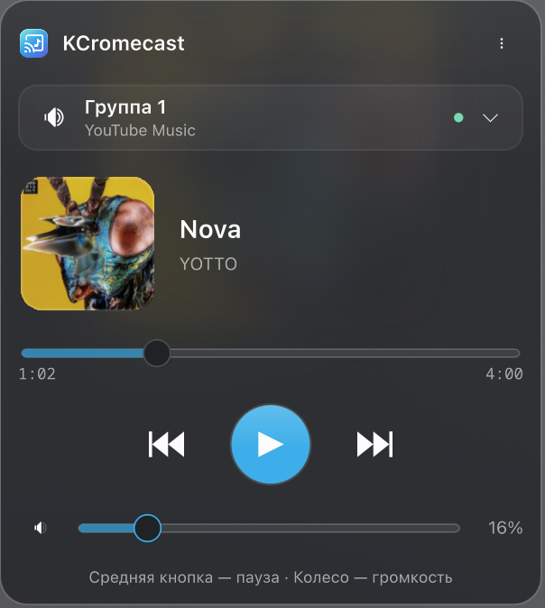
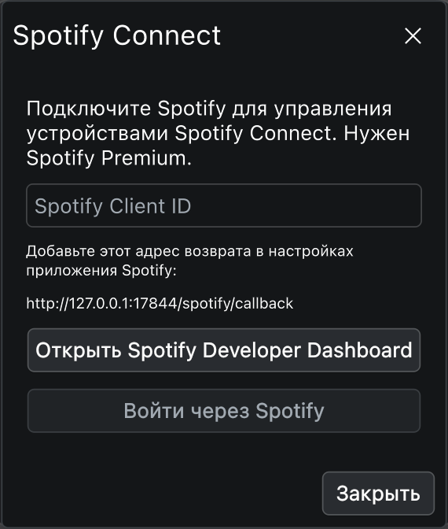

# KCromecast

Пульт Chromecast для панели KDE Plasma. Включите музыку на телефоне, выберите колонки — и управляйте воспроизведением с компьютера. Firefox или Chrome для работы пульта не нужны.

KCromecast — самостоятельный форк концепции [KCast](https://github.com/Agundur-KDE/KCast). Интерфейс и модуль связи переработаны. У проекта собственный идентификатор `org.kcromecast.widget`, исходники, установщик и версия; обновления KCast его не затрагивают.

## Интерфейс

Компактная обложка рядом с названием трека, исполнителем и альбомом. Обычный размер пульта — 352 × 392 логических пикселя; уведомление или таймер добавляет небольшую строку. Внизу постоянно видна подсказка про среднюю кнопку и колесо на значке в панели. Название трека, исполнителя и альбома можно выделить мышью и скопировать через Ctrl+C. Правая кнопка открывает копирование и поиск в интернете, YouTube Music и Spotify; без выделения копируется весь текст выбранного поля, включая скрытую часть длинного названия.

Прозрачные поверхности с тонкими границами и мягким свечением от обложки сочетаются с цветами, шрифтами и элементами управления KDE. Светлая и тёмная палитры берутся из системы. В настройках можно изменить плотность стекла и уменьшить анимацию. Размытие самого окна выполняет композитор Plasma, если его поддерживает выбранная тема.

Главный экран содержит только выбор колонок, прогресс, предыдущий трек, паузу/продолжение, следующий трек и громкость. Таймер сна и остановка находятся в меню «Дополнительно». Списки файлов, ссылки, запуск трансляции рабочего стола и настройки сети не занимают основной экран.



## Возможности

- Подхват существующих Cast-сессий: YouTube Music, Spotify и другие приложения, использующие стандартное управление Google Cast. Источник определяется автоматически, Spotify отмечается отдельным значком. Поддерживаются обложка, трек, исполнители, альбом и доступные команды приёмника.
- Отдельные колонки и заранее созданные группы Google Home; автоматическое обнаружение по mDNS.
- Постоянные соединения и события состояния. После пробуждения компьютера, смены сети и команды «Переподключить колонки» пересоздаются сетевое обнаружение и подключения; трансляция на колонках продолжает жить независимо от пульта.
- Интеграция MPRIS: отдельный плеер KCromecast в управлении музыкой KDE, метаданные, обложка, перемотка, громкость и мультимедийные клавиши. Клавиши действуют на плеер, выбранный системой; KCromecast не перехватывает их у других приложений.
- Передача изменений в интерфейс через локальный WebSocket, расчёт прогресса в открытом пульте. При недоступности потока событий используется резервный HTTP-опрос.
- Предыдущий/следующий трек и перемотка с учётом возможностей активного приёмника. Недоступные команды отключены.
- Обложки до 512 × 512 с учётом пропорций, отдельный пул загрузки, повторное использование и задержка повторных попыток. Кэш ограничен 128 файлами и 64 МиБ, текущие обложки защищены от удаления. Графические эффекты отключаются при закрытом пульте.
- Громкость и выключение звука; фактическое значение синхронизируется с колонками.
- Средняя кнопка на значке: пауза/продолжение. Колесо: относительная громкость без скачков.
- Клавиши в открытом пульте: пробел — пауза; стрелки — треки. В ползунках стрелки управляют их значениями.
- Таймер сна на 15, 30, 45 или 60 минут либо произвольное время от 1 до 1440 минут. Срок и устройство сохраняются при перезапуске службы. Можно включить плавное уменьшение громкости на 5–300 секунд перед паузой; после неё восстанавливается прежняя громкость. Изменение громкости вручную во время затухания отменяет таймер. Пока таймер не установлен, его поток не выполняет периодических проверок.
- Поиск трека в браузере и копирование строки «исполнитель — название» через меню правой кнопки.
- Дополнительное управление устройствами Spotify Connect после входа в аккаунт. Без подключения Spotify его модуль ждёт событий и не опрашивает интернет.
- Язык интерфейса выбирается автоматически по первому языку интерфейса системы: русский (`ru`, включая региональные варианты) — русский; любой другой — английский. Вторичные языки и язык форматов чисел это правило не меняют. Переводятся меню, настройки, подсказки и сообщения службы; названия музыки и устройств сохраняются как переданы колонками.
- Подписи для средств доступности, управление с клавиатуры и копирование метаданных.

## Требования и совместимость

KDE Plasma 6, Qt 6.6 или новее с QML-модулем QtWebSockets, Python 3.11 или новее. Для установки: `kpackagetool6`, `qdbus6`, `msgfmt`, Python с модулем `venv` и пользовательский systemd.

Используются импорты Qt/KDE без фиксированных версий и `QtQuick.Effects.MultiEffect`. Нет зависимости от Plasma5Support, устаревших DataSource/executable, Qt Graphical Effects или внутренних QML-модулей Plasma. Модуль связи работает напрямую через публичный API PyChromecast, без `catt`.

Зависимости имеют диапазоны совместимых версий; установщик обновляет их и сохраняет фактический состав в `~/.local/share/kcromecast/requirements.lock`. Новые основные версии PyChromecast требуют проверки перед расширением диапазона. Совместимость с ещё не выпущенными Plasma/Qt не заявляется как проверенная.

## Установка и обновление

```sh
python3 scripts/install.py
```

Установщик работает от текущего пользователя, создаёт отдельное виртуальное окружение и фоновую службу `kcromecast.service`. Если в панели есть KCast, заменяет его на KCromecast на той же позиции. Настройки панели и прежняя версия форка сохраняются в `~/.local/share/kcromecast/backup-*`.

При обновлении уже загруженного QML может потребоваться перезапуск панели:

```sh
systemctl --user restart plasma-plasmashell.service
```

Архив `.plasmoid` содержит интерфейс; для нового компьютера нужен также модуль связи. Рекомендуемый способ установки полного комплекта — исходный архив и команда выше.

Компьютер и колонки должны находиться в одной локальной сети. Ethernet на компьютере и Wi-Fi на колонках совместимы, если роутер пропускает mDNS и соединения между ними. Создание и изменение состава групп выполняется в Google Home. Spotify через Google Cast работает без подключения аккаунта к пульту. Для устройств Spotify Connect доступен отдельный модуль официального Spotify Web API. Управление чужими очередями ограничено возможностями конкретного Cast-приложения; библиотека YouTube Music на компьютере автоматически не переносится.

## Подключение Spotify Connect

В меню «Дополнительно → Spotify Connect…» есть поле Client ID, адрес возврата и кнопка входа.



1. Откройте [Spotify Developer Dashboard](https://developer.spotify.com/dashboard) кнопкой в окне и создайте личное приложение с Web API.
2. Добавьте точный Redirect URI: `http://127.0.0.1:17844/spotify/callback`.
3. Если требуется, внесите свой Spotify-аккаунт в список пользователей приложения. Скопируйте Client ID в виджет и нажмите «Войти через Spotify».
4. Завершите вход в браузере. Устройства Spotify появятся в общем списке. Выбор устройства задаёт цель управления; кнопка Play на неактивном устройстве передаёт ему текущее воспроизведение аккаунта.

Используется [Authorization Code with PKCE](https://developer.spotify.com/documentation/web-api/tutorials/code-pkce-flow), без Client Secret и пароля в виджете. Для управления воспроизведением нужен Spotify Premium; для личного приложения действуют [ограничения Development Mode](https://developer.spotify.com/documentation/web-api/concepts/quota-modes). Некоторые устройства и команды Spotify API недоступны; они отключаются в интерфейсе. Отдельного mute в Web API нет — у Spotify Connect доступен регулятор громкости.

Токены хранятся только в `~/.config/kcromecast/spotify.json` с правами 0600. «Отключить аккаунт» удаляет их из файла. Для отзыва разрешения на стороне Spotify используйте список приложений в аккаунте Spotify. Ограничения частоты запросов, Retry-After и исчерпание квоты обрабатываются без немедленных повторов. Spotify Web API требует опроса состояния: 5 секунд при воспроизведении, 15 при паузе; поток событий устраняет опрос между виджетом и локальной службой.

Таймер выполняется компьютером: пока компьютер выключен или спит, послать команду колонкам невозможно. Служба проверяет сохранённый срок при запуске и пробуждении; если колонки недоступны после истечения срока, повторяет попытки ограниченное время. Время на компьютере должно быть настроено правильно.

## Архитектура

`package/` — интерфейс Plasma, SVG-значок и настройки KConfig. `backend/kcromecast/` — обнаружение, соединения, метаданные, обложки и команды. `scripts/` — установка и сборка. `tests/` — проверки поведения.

Интерфейс получает изменения через `127.0.0.1:17845/v1/events`. Команды и резервные снимки доступны на `127.0.0.1:17844`. HTTP проверяет Host и Bearer-токен, поток событий — Host, отсутствие браузерного Origin и отдельное первое сообщение авторизации. Очередь состояния хранит только самый свежий снимок. Запросы ограничены по размеру, времени и параллельности; интерфейс последовательно отправляет команды и объединяет ожидающие изменения громкости. Сроки таймера, выбранное устройство и токены записываются атомарно в отдельные файлы. Токен не входит в исходники или дистрибутив. Не открывает CORS для веб-страниц. Пароли Google и cookies браузера не используются.

## Проверка и сборка

```sh
python3 scripts/translations.py
~/.local/share/kcromecast/venv/bin/python -m unittest discover -s tests -v
qmllint -I /usr/lib/qt6/qml package/contents/ui/*.qml
QT_QPA_PLATFORM=offscreen /usr/lib/qt6/bin/qmltestrunner -input tests/qml
python3 scripts/build.py
```

Переводы хранятся в `translations/en.po` и `translations/ru.po`. Установка и сборка компилируют оба каталога и общий `Translations.js`; `Locale.js` применяет правило выбора только русского или английского. При изменении текстов обновляйте оба PO-файла. Проверка локализации запускает Qt 6 с разными системными языками, проверка QML — выделение и копирование текста.

Артефакты появятся в `dist/`: пакет виджета и полный исходный архив. QML дополнительно проверяется в запущенной Plasma; реальное управление проверяется на колонках, поскольку модель приёмника и приложение влияют на набор команд.

Журнал службы:

```sh
journalctl --user -u kcromecast.service -b
```

## Авторство и лицензия

KCromecast contributors, 2026. GPL-3.0-or-later, см. `LICENSE`.

Основан на идее и пользовательском сценарии KCast, автор Alec / Agundur, 2025. Новый интерфейс и модуль связи написаны для KCromecast. PyChromecast и его зависимости остаются отдельными библиотеками со своими лицензиями. Названия Google Cast, Chromecast, KDE, Breeze и Apple принадлежат их владельцам; проект с ними не аффилирован.
