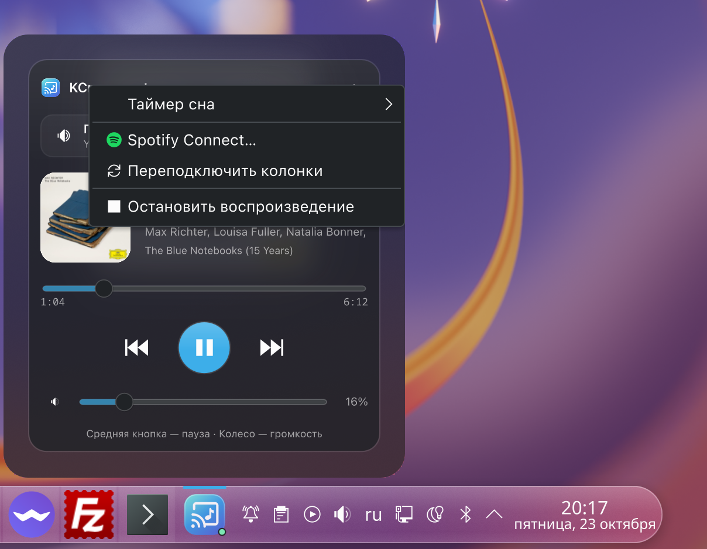
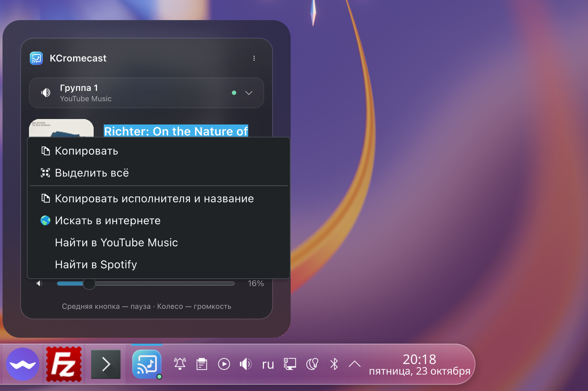
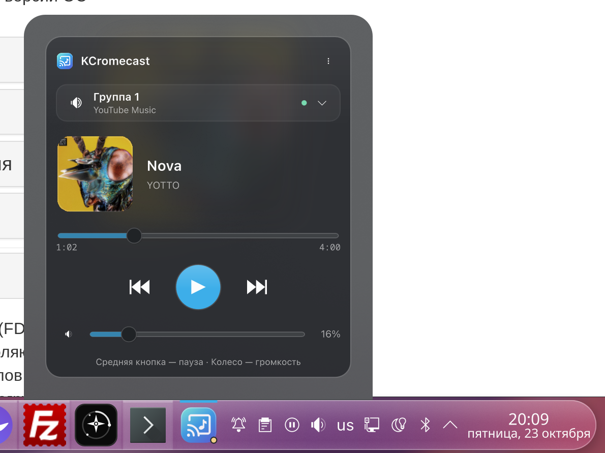

# KCromecast

[English](README.md) · **Русский**

Пульт Chromecast для панели KDE Plasma. Включите музыку на телефоне, выберите колонки и управляйте воспроизведением с компьютера. Можно пользоваться Firefox, Chrome или любым другим браузером — расширение не требуется.


## Установка

Откройте терминал в **KDE Plasma 6** и выполните:

```sh
curl -fsSL https://raw.githubusercontent.com/military1/KCromecast/main/install.sh | bash
```

Установщик проверит требования, установит недостающие пакеты в Arch и производных, Debian/Ubuntu или Fedora, поставит виджет и фоновую службу для вашего пользователя и добавит значок в панель. Права администратора нужны только для системных пакетов. Панели Plasma перезагрузятся, приложения останутся открытыми.

Другой способ: скачать [последний выпуск](https://github.com/military1/KCromecast/releases/latest), распаковать **архив исходников** и выполнить `bash install.sh`. Один файл `.plasmoid` **не устанавливает** фоновую службу.

Для обновления выполните ту же команду. Настройки и подключение Spotify сохранятся. Папку со скачанными исходниками после установки можно удалить.

<details>
<summary>Параметры установщика</summary>

```sh
bash install.sh --check                 # Только проверить требования
bash install.sh --no-system-packages    # Не запускать системный менеджер пакетов
bash install.sh --no-restart            # Загрузить новый интерфейс при следующем входе
bash install.sh --no-panel              # Добавить виджет вручную через список виджетов Plasma
```

В других дистрибутивах можно установить нужные зависимости самостоятельно. Установщик не обновляет Plasma 5 до Plasma 6.

</details>

## Возможности

- Управление существующими трансляциями Google Cast, включая YouTube Music и Spotify Cast.
- Поиск колонок и готовых групп Google Home в локальной сети.
- Пауза, продолжение, переключение треков, перемотка, громкость и отключение звука — если их поддерживает приёмник.
- Название трека, исполнитель, альбом и обложка; выделение, копирование и поиск трека в браузере.
- Средняя кнопка на значке — пауза/продолжение, колесо — громкость.
- Системное управление музыкой KDE и мультимедийные клавиши через MPRIS.
- Таймер сна с произвольной длительностью, плавным уменьшением громкости и сохранением при перезапуске службы.
- Дополнительное управление Spotify Connect через официальный Spotify Web API.
- Русский интерфейс при русском языке системы; английский при любом другом.

Изменения от колонок передаются в виджет по локальному соединению. Обложки кэшируются, а эффекты отключаются при закрытом окне.

<details>
<summary>Другие скриншоты</summary>





</details>

## Требования и совместимость

| Компонент | Требование |
| --- | --- |
| Рабочий стол | KDE Plasma **6.0+** в пределах ветки Plasma 6 |
| Qt | **6.6+**, включая QML-модули QtWebSockets и QtQuick.Effects |
| Python | **3.11+** |
| Сеанс | Запущенная Plasma и работающий пользовательский systemd |
| Сеть | Компьютер и колонки в одной локальной сети, разрешён mDNS |

Текущая версия проверена на **Plasma 6.8.1, Qt 6.12.0 и Wayland** с двумя Technics SC-C30 и их группой Cast. Plasma 6.0 / Qt 6.6 — минимальный уровень используемых API; это не означает, что проверена каждая промежуточная версия. Plasma 5 и будущие основные версии Plasma не поддерживаются. Подробнее — в [docs/TESTING.md](docs/TESTING.md).

Виджет использует публичные API Qt/KDE, без Plasma5Support и `catt`. Размытие и прозрачность зависят от темы Plasma и композитора. Компьютер по кабелю и колонки по Wi-Fi совместимы, если роутер пропускает локальный трафик.

## Spotify Connect

Для Spotify Cast вход в KCromecast не нужен. Для Spotify Connect откройте **⋮ → Spotify Connect…**, создайте личное приложение в [Spotify Developer Dashboard](https://developer.spotify.com/dashboard) и укажите его Client ID.

В настройках приложения добавьте точный адрес возврата:

```text
http://127.0.0.1:17844/spotify/callback
```

Нажмите **«Войти через Spotify»** и завершите вход в браузере. Устройства Connect появятся в списке колонок. Кнопка воспроизведения на неактивном устройстве передаёт ему текущее воспроизведение аккаунта.

Для управления воспроизведением нужен Spotify Premium и доступ аккаунта к приложению. Действуют [ограничения режима разработки Spotify](https://developer.spotify.com/documentation/web-api/concepts/quota-modes). Некоторые устройства не предоставляют управление громкостью или воспроизведением. Токены хранятся локально с доступом только для пользователя; пароль и Client Secret виджет не запрашивает. Живое воспроизведение Spotify Connect с авторизованным аккаунтом пока не проверено.

## Ограничения

Это пульт, а не отправитель звука. Он не транслирует вкладки Firefox, звук рабочего стола или локальные файлы. Сначала запустите Cast из музыкального приложения. Группы создаются в Google Home. Команды очереди и перемотки зависят от приложения на приёмнике.

Таймер работает на компьютере. Он не может остановить музыку, пока компьютер выключен или спит. Для просроченного таймера есть двухминутное окно повторных попыток; более старый таймер сбрасывается, чтобы не остановить новую сессию. Ручное изменение громкости во время затухания отменяет таймер.

## Удаление

```sh
bash ~/.local/share/kcromecast/uninstall.sh
```

Настройки и резервные копии сохранятся. Добавьте `--purge`, чтобы удалить и их, и сохранённые токены Spotify. Учитываются стандартные каталоги XDG для данных, настроек и кэша.

При проблемах со связью попробуйте **⋮ → Переподключить колонки** и посмотрите журнал:

```sh
journalctl --user -u kcromecast.service -n 50
```

В [сообщении об ошибке](https://github.com/military1/KCromecast/issues) укажите версии Plasma/Qt, модель колонок и что именно произошло.

## Разработка

Проверки описаны в [docs/TESTING.md](docs/TESTING.md), изменения — в [CHANGELOG.md](CHANGELOG.md).

GPL-3.0-or-later. Разработку ведёт [military1](https://github.com/military1). Основан на идее [KCast](https://github.com/Agundur-KDE/KCast) от Alec / Agundur. KDE, Google Cast и Spotify — товарные знаки их владельцев.
